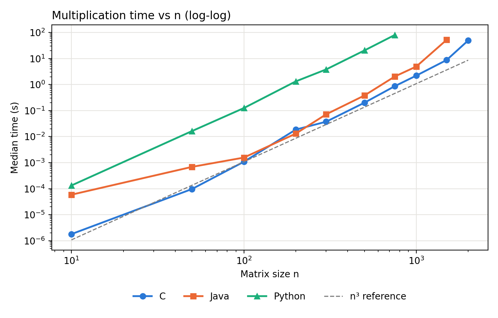
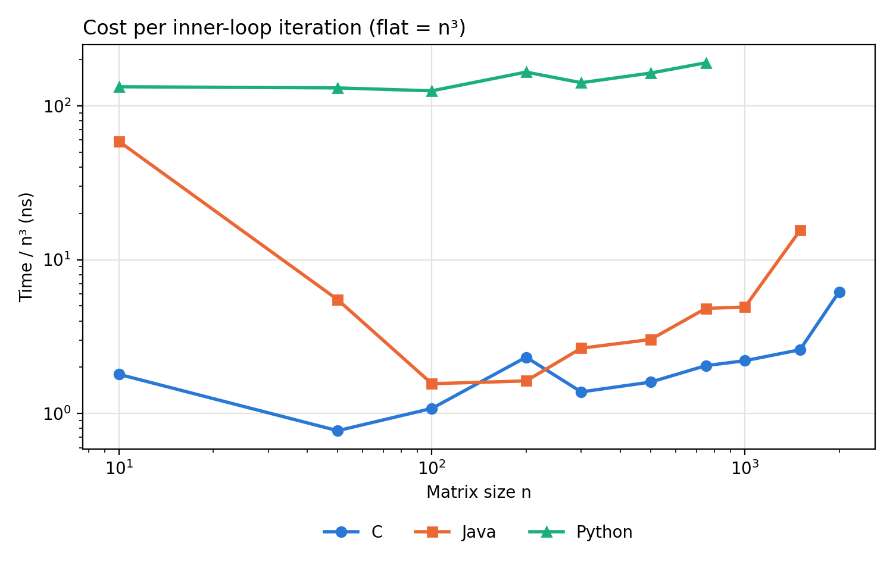
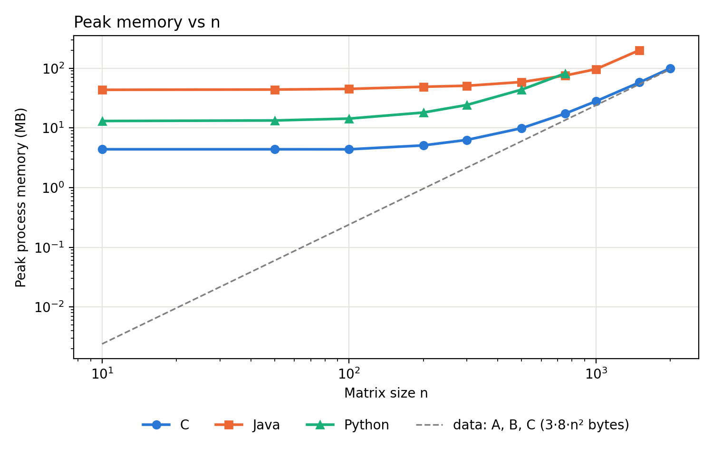
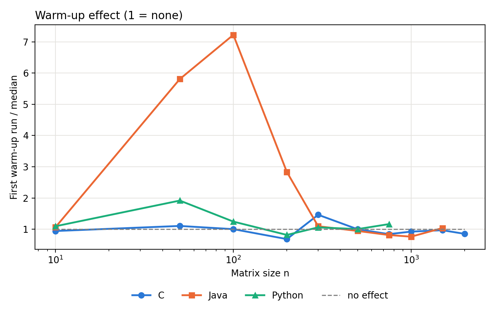

# Assignment 1 — Basic Matrix Multiplication in Python, Java and C

**Course:** Big Data · **Degree:** Data Science and Engineering ·
**University:** Universidad de Las Palmas de Gran Canaria · **Year:** 2026–2027

## Overview

This assignment is an empirical study of the basic dense matrix
multiplication algorithm implemented in three languages with very different
execution models: Python (interpreted), Java (bytecode + JIT compilation) and
C (compiled ahead of time). The same algorithm, the same input matrices and
the same measurement protocol are used in all three, so that differences in
the results can be attributed to the language and its runtime.

## Research question

How do execution time and memory use grow with the matrix size *n* for the
basic triple-loop algorithm, and how close is that growth to the theoretical
O(n³) model in Python, Java and C?

## Algorithm

All implementations compute C = A × B for two n × n matrices with the
classic triple loop in **i-j-k order**, accumulating each element in a local
variable:

```text
for i in 0..n-1
    for j in 0..n-1
        s = 0
        for k in 0..n-1
            s += A[i][k] * B[k][j]
        C[i][j] = s
```

- Time complexity: O(n³) — n³ multiply-add operations.
- Storage: 3 · n² values of 8 bytes (A, B and C).

No matrix-multiplication library is used in the implementations. NumPy is
used only in the correctness tests, as a reference.

The i-j-k order reads A row by row (contiguous in memory) but B **column by
column**, jumping n elements between consecutive reads. This access pattern
is the key to explaining the results for large n.

## Implementations

| Language | File | Matrix storage |
|---|---|---|
| Python | `python/matmul.py` | list of lists of Python `float` objects |
| Java | `java/MatMul.java` | `double[][]`: an array of separate row arrays |
| C | `c/matmul.c` | one contiguous `double` block, element (i, j) at `m[i*n + j]` |

All three use 64-bit floating point (`float`/`double`), read the same input
files, and print one line per run with the time and a checksum (sum of all
elements of C). The checksum is identical in the three languages for every n.

## Experimental setup

| Component | Configuration |
|---|---|
| CPU | 13th Gen Intel Core i5-1335U — hybrid: 2 performance + 8 efficient cores, 12 threads, 12 MB L3 cache |
| RAM | 16 GB |
| OS | Windows 11 (10.0.26200) |
| Python | 3.12.3 (CPython) |
| Java | OpenJDK 25.0.1, default JVM settings |
| C compiler | GCC 16.2.0 (MinGW-w64, WinLibs), flag `-O2` |

The full description is saved automatically with every benchmark run in
`results/raw/environment_<date>.txt`. The laptop was plugged in and no other
applications were running during the measurements.

## Methodology

**Input data.** `data/generate_matrices.py` creates A and B for each n with
Python's `random.Random`, fixed seed 42, values uniform in [0, 1), and saves
them as raw little-endian float64 files (`A_<n>.bin`, `B_<n>.bin`). Using
files instead of generating the data in each language guarantees that the
three programs multiply exactly the same numbers (each language's random
generator would give different values for the same seed).

**Sizes.** n = 10, 50, 100, 200, 300, 500, 750, 1000, 1500, 2000.

**What is timed.** Only the multiplication itself, with a monotonic timer
(`time.perf_counter_ns` in Python, `System.nanoTime` in Java,
`QueryPerformanceCounter` in C on Windows). Reading the files, allocating C
and computing the checksum are outside the timed interval.

**Repetitions.** For each language and n, a single process runs the
multiplication 2 times as warm-up (discarded) and then 5 measured times. The
warm-up is the same for all languages; it matters mainly for Java, whose JIT
compiler optimises the code while it runs. Results are summarised with the
**median** and the **interquartile range (IQR)**, which are robust to
occasional slow runs.

**Memory.** Peak working set of the whole process, read from Windows after
the process ends. It includes the interpreter or JVM, not only the matrices.

**Budget.** 120 s per multiplication, fixed before running. Before each new
size, the driver predicts its time from the previous size with the n³ model;
if the prediction exceeds the budget, the size is not run and is recorded as
`skipped_budget` in the CSV.

## Correctness

`tests/test_correctness.py` runs the three implementations on six cases and
compares the full result matrix:

- a hand-computed 2×2 case (non-symmetric, so A·B ≠ B·A would be detected);
- n = 1;
- A × I = A and A × 0 = 0 (n = 50);
- random matrices of size 64 and 101 compared with NumPy.

The comparison uses `rtol = 1e-9`, `atol = 1e-12`, because NumPy adds the
products in a different order. All 18 checks pass; the largest difference
with NumPy is 2.1·10⁻¹⁴. The tests were also checked to fail when an index
is deliberately broken in the C code.

## Results

### Execution time

Median of 5 runs, in seconds (IQR as % of the median in `results/summary.csv`):

| n | C | Java | Python |
|---:|---:|---:|---:|
| 10 | 0.0000018 | 0.000059 | 0.00013 |
| 50 | 0.000097 | 0.00069 | 0.016 |
| 100 | 0.0011 | 0.0016 | 0.125 |
| 200 | 0.019 | 0.013 | 1.32 |
| 300 | 0.037 | 0.072 | 3.81 |
| 500 | 0.200 | 0.379 | 20.4 |
| 750 | 0.864 | 2.03 | 80.2 |
| 1000 | 2.21 | 4.92 | over budget |
| 1500 | 8.77 | 52.3 | over budget |
| 2000 | 49.5 | over budget | over budget |



Python is roughly 100 times slower than C (between 70× and 170× depending
on n): each multiply-add costs it 125–190 ns, against about 1–2.5 ns in C up
to n = 1500, because every operation goes through the interpreter and works on
boxed `float` objects. Java is slow for small n (fixed JVM and JIT costs), but
for 100 ≤ n ≤ 1000 it stays within 2.4× of C, and is even faster at n = 200.

### Growth compared with the n³ model

The empirical exponent is the slope of log(time) against log(n), fitted on
all sizes with n ≥ 100 (smaller sizes are dominated by fixed costs and timer
resolution):

| Language | Exponent | Sizes used |
|---|---:|---|
| C | 3.40 | 100–2000 |
| Java | 3.76 | 100–1500 |
| Python | 3.17 | 100–750 |

The cost per multiply-add (time / n³) shows where the growth departs from the
model; a flat line would mean perfect n³ scaling:



- **Python** stays almost flat: the interpreter overhead is so large that
  memory effects are hidden.
- **Java** jumps from 4.9 ns to 15.5 ns per operation between n = 1000 and
  n = 1500 (time ×10.6 where the model predicts ×3.4).
- **C** jumps from 2.6 ns to 6.2 ns between n = 1500 and n = 2000 (time ×5.6
  where the model predicts ×2.4).

These jumps are consistent with the cost of reading B column by column once
the matrices no longer fit in the 12 MB L3 cache (B alone is 8 MB at
n = 1000, 18 MB at n = 1500 and 32 MB at n = 2000): each read of B then has to
go to main memory. Java degrades earlier than C, which matches its layout,
where every row of B is a separate object in memory. Confirming the exact
cause would require hardware performance counters, which were not measured.

### Memory

Peak process memory in MB, compared with the size of the three matrices:

| n | Data (A+B+C) | C | Java | Python |
|---:|---:|---:|---:|---:|
| 10 | 0.002 | 4.4 | 43.5 | 13.1 |
| 100 | 0.24 | 4.4 | 45.1 | 14.3 |
| 500 | 6.0 | 9.9 | 58.8 | 43.9 |
| 750 | 13.5 | 17.4 | 75.5 | 81.9 |
| 1000 | 24.0 | 28.0 | 96.7 | — |
| 1500 | 54.0 | 58.0 | 201.1 | — |
| 2000 | 96.0 | 100.1 | — | — |



- **C** uses the matrices plus a constant ~4 MB: at n = 2000, 100 MB for
  96 MB of data.
- **Python** needs, on top of the ~13 MB of the interpreter, about 5 times
  the size of the data, because each element is a separate 24-byte `float`
  object plus an 8-byte pointer in the list, instead of 8 bytes.
- **Java** has a fixed cost of ~43 MB for the JVM. Above that, its peak grows
  faster than the data because the heap is resized in steps and garbage is
  not collected immediately (201 MB at n = 1500 for 54 MB of data).

### Warm-up

Ratio between the first warm-up run and the median of the measured runs
(1 = no warm-up effect):



In Java, the first run is 5.8 times slower at n = 50 and 7.2 times slower at
n = 100: the code starts interpreted and is compiled by the JIT while it
runs. From n = 300 the effect disappears, because a single multiplication is
long enough for the JIT to compile it early. In C and Python the ratio stays
around 1, as expected for code that is either already compiled or never
compiled.

## Limitations

- **Single machine and configuration.** The results apply to this laptop,
  these runtime versions and these flags (`-O2`, default JVM). They do not
  show that one language is always faster.
- **Hybrid CPU.** Windows may run a process on a performance or an efficient
  core, and frequency changes with temperature. This explains the larger IQR
  at some sizes (e.g. 65% for C at n = 200, the only size where Java beats C).
- **Timer resolution.** For n = 10 in C a multiplication takes 1.8 µs, close
  to the timer resolution (0.1 µs on Windows), so that value is imprecise.
- **Memory metric.** Peak process memory includes the runtime and is not the
  memory used by the matrices alone.
- **Budget.** Python only reaches n = 750 and Java n = 1500, so the
  comparison at the largest sizes is only partial.

## Conclusions

1. On this machine, the basic algorithm is roughly 100× slower in Python than
   in C, while Java stays within 2.4× of C for 100 ≤ n ≤ 1000.
2. Only Python follows the n³ model closely (exponent 3.17). In C and Java,
   time grows faster than n³ for large n, consistent with the column-wise
   access to B no longer fitting in the cache. The model counts operations
   but ignores the cost of memory accesses.
3. Memory use is dominated by the runtime for small n (JVM ~43 MB, Python
   ~13 MB, C ~4 MB) and by the data representation for large n, where Python
   needs about 5 bytes of memory for every byte of matrix data.
4. Java needs warm-up for fair measurements: without it, small sizes would
   appear up to 7× slower.

These results motivate assignment 2: changing the loop order (i-k-j) or
using blocking should remove the column-wise access to B, the main cause of
the slowdown observed here.

## How to reproduce

All commands are run from the **repository root** (requirements in the main
README: `pip install -r requirements.txt`, a Java JDK and GCC).

```bash
# Correctness tests (compiles Java and C, compares with known results and NumPy)
python assignment1/tests/test_correctness.py

# Full benchmark (~30 min). Generates the input matrices if needed and writes
# results/raw/benchmark_<date>.csv and results/raw/environment_<date>.txt
python assignment1/benchmarks/run_benchmarks.py

# Analysis of the newest CSV: results/summary.csv and results/figures/*.png
python assignment1/analysis/analyze.py
```

Benchmark options: `--sizes`, `--languages`, `--warmup`, `--reps`, `--budget`.
A quick trial (`--sizes 10 50 100 --reps 2 --warmup 1`) also writes a CSV in
`results/raw/`; delete it afterwards, since the analysis uses the newest file.

Each implementation can also be run alone, e.g.
`python assignment1/python/matmul.py 100 --warmup 2 --reps 5`
(Java: `java -cp assignment1/java MatMul 100`, C on Windows:
`assignment1\c\matmul.exe 100`).

## Project structure

```text
assignment1/
├── data/generate_matrices.py     shared input matrices
├── python/matmul.py              Python implementation
├── java/MatMul.java              Java implementation
├── c/matmul.c                    C implementation
├── tests/test_correctness.py     correctness tests
├── benchmarks/run_benchmarks.py  benchmark driver
├── analysis/analyze.py           statistics and figures
└── results/
    ├── raw/                      raw CSV (every run) + environment
    ├── summary.csv               median, IQR, memory, time/n³, warm-up
    └── figures/                  figures shown above
```

## Use of AI

Claude was used as an assistant to discuss the experimental design, write and review parts of the code and scripts, and draft parts of the
documentation.