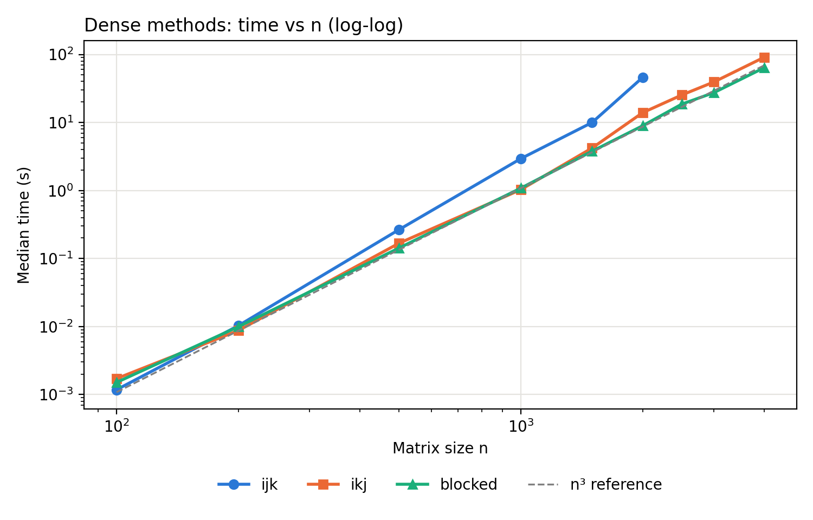
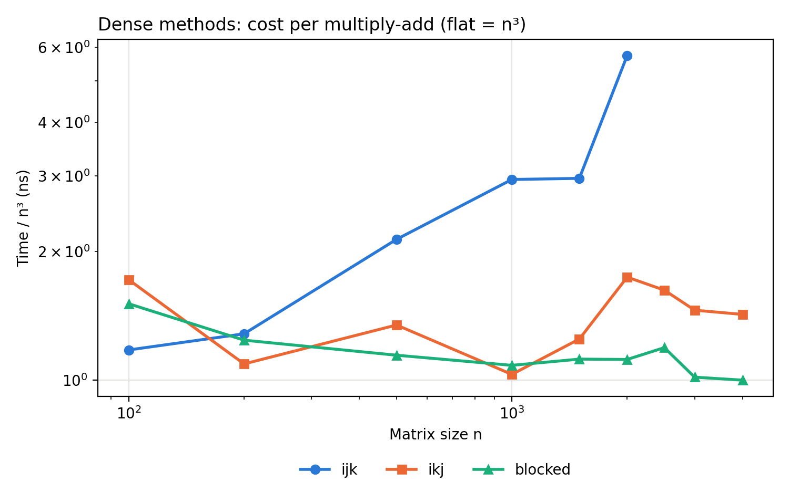
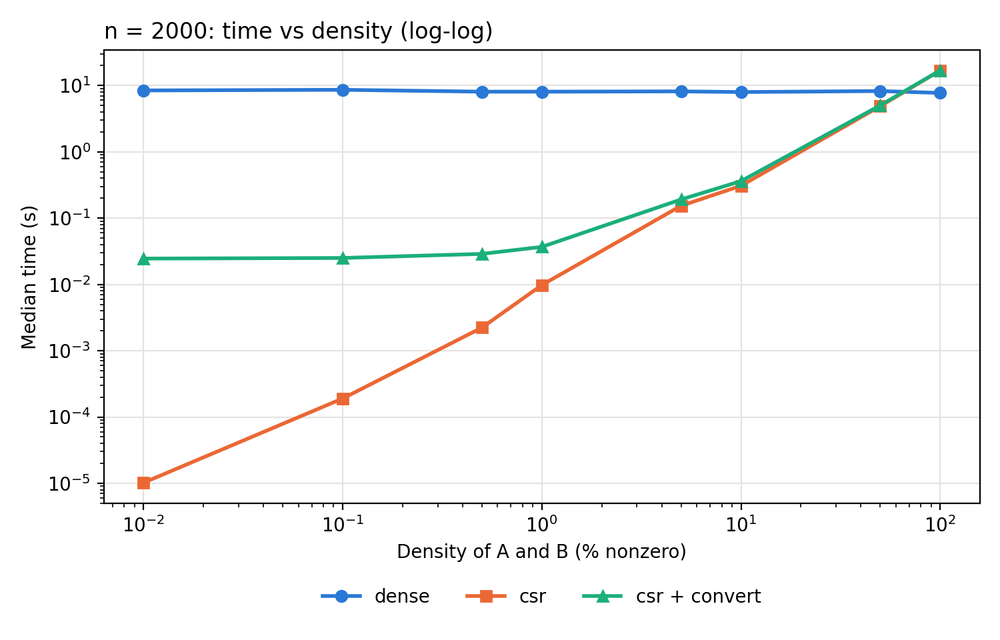
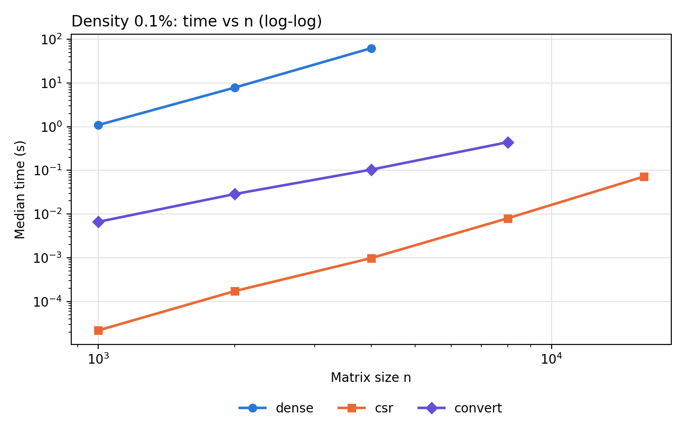

# Assignment 2 — Optimised Dense Multiplication and Sparse Matrices

## Overview

Assignment 1 showed that the basic i-j-k algorithm in C grows faster than n³
for large matrices, which is consistent with reading the second matrix by
columns once it no longer fits in the cache. This assignment studies two
questions on the same machine, in C:

- **Part A (dense optimisation):** do loop reordering (i-k-j) and cache
  blocking remove that slowdown, and by how much do they reduce the time?
- **Part B (sparse matrices):** under which tested densities does a sparse
  CSR representation beat a dense multiplication, and how much do the
  conversion and the density of the output reduce that advantage?

All methods are sequential (single thread).

## Methods

### Part A — three dense methods (`c/dense.c`)

| Method | Change | Expected effect |
|---|---|---|
| `ijk` | none: the Assignment 1 algorithm (baseline) | inner loop reads B by columns (stride n) |
| `ikj` | the two inner loops are swapped | B and C are read and written row by row (stride 1) |
| `blocked` | ikj applied to 64 × 64 blocks | each block of B and C is reused while it is in the cache |

The three methods perform the same n³ multiply-adds on the same row-major
`double` arrays and the same input matrices. The timed region of every method
is **setting C to zero + the multiplication**: ikj and blocked accumulate into
C, so C must start at zero; for ijk this adds only an O(n²) cost, to keep the
same timing boundary for the three methods.

### Part B — CSR versus dense (`c/sparse.c`)

- **Sparse format:** CSR (compressed sparse row: `row_ptr`, `col`, `val`).
  CSR × CSR → CSR with Gustavson's row-by-row algorithm, using a dense
  accumulator and a marker array per row. All the code is my own; no sparse
  library is used.
- **Dense method:** the blocked method of Part A (block 64), run on the same
  matrices stored with their zeros.
- **Matched inputs:** `sparse.c` generates A and B itself. For each element,
  in row-major order, a uniform number u is drawn; the element is nonzero if
  u < density, and its value is then drawn uniformly in [0, 1). A is generated
  first, then B, from one splitmix64 stream seeded with (seed 42, n, density).
  The dense and CSR modes therefore multiply exactly the same logical
  matrices (checked by the tests). Nonzeros are uniformly distributed.
- **Density and sparsity:** density = percentage of nonzero entries;
  sparsity = 100 − density.
- **Conversion cost:** measured **separately** by the `convert` mode (dense →
  CSR for A and B); it is not included in the `csr` time. Both values are
  reported, and their sum is shown as `csr + convert`.
- **Timed regions:** `dense`: zeroing C + multiplication; `csr`: the
  multiplication, including building the CSR arrays of C; `convert`: the
  conversion of A and B. Generation is never timed.

## Experimental setup

| Component | Configuration |
|---|---|
| CPU | 13th Gen Intel Core i5-1335U — hybrid: 2 performance + 8 efficient cores, 12 threads, 12 MB L3 cache |
| RAM | 16 GB |
| OS | Windows 11 (10.0.26200) |
| C compiler | GCC 16.2.0 (MinGW-w64, WinLibs), flag `-O2` |
| Vectorisation | `gcc -fopt-info-vec-optimized` reported **no loops vectorised** |
| Threads | single-threaded |

The laptop was plugged in during all runs, with a web browser open and light
use. The environment of each run is saved in `results/raw/*env*.txt`.

**Protocol (all experiments):** 1 warm-up run (excluded) + 5 measured runs
per configuration, in one process; median and interquartile range (IQR).
Assignment 1 showed no warm-up effect in C, so one warm-up run is enough.
Memory is the peak working set of the process (`GetProcessMemoryInfo`); for
Part B the size of the data structures is also reported (dense: 24n² bytes;
CSR: 12 bytes per nonzero + 4(n + 1) bytes per matrix).

**Budgets, declared before running:** 120 s per multiplication (a size is not
run if the n³ model predicts it would exceed it; recorded as
`skipped_budget`), and, for Part B, 4 GB for the dense arrays (recorded as
`skipped_memory`). A process is stopped if it exceeds 1.5 × the budget for
all its runs (recorded as `timeout`).

## Correctness

- `tests/test_dense.py`: 7 cases (hand-computed 2×2, n = 1, A × I, A × 0,
  random n = 64, 101, 130) for ijk, ikj and blocked with block sizes 7, 64
  and 500, so blocks that do not divide n and blocks larger than n are
  tested: 35 checks.
- `tests/test_sparse.py`: n = 1, 7, 64, 101, 200 × density 0, 0.5, 5, 50,
  100 %: checks that the dense and CSR modes generate identical A and B, that
  both results equal A × B, and that `convert` finds the same nonzeros:
  25 checks.

Results are compared with NumPy (reference only) using
|x − y| ≤ atol + rtol·|y|, rtol = 1e-9, atol = 1e-12. All checks pass, and
both test scripts were checked to fail when a bug is introduced on purpose
(edge blocks in `dense.c`, the accumulator in `sparse.c`).

## Results — Part A

Median time (s) of 5 runs; sizes 100–4000:

| n | ijk | ikj | blocked |
|---:|---:|---:|---:|
| 500 | 0.267 | 0.168 | 0.143 |
| 1000 | 2.94 | 1.03 | 1.08 |
| 1500 | 9.99 | 4.21 | 3.78 |
| 2000 | 45.9 | 13.9 | 8.94 |
| 2500 | timeout | 25.3 | 18.6 |
| 3000 | over budget | 39.3 | 27.4 |
| 4000 | over budget | 91.1 | 64.0 |

`ijk` at n = 2500 exceeded the process limit (1110 s for 6 runs, i.e. more
than 185 s per multiplication on average), above the 120 s budget.



The cost per multiply-add (time / n³) is constant if the time grows exactly
as n³:



| n | ijk (ns) | ikj (ns) | blocked (ns) |
|---:|---:|---:|---:|
| 1000 | 2.94 | 1.03 | 1.08 |
| 2000 | 5.73 | 1.74 | 1.12 |
| 4000 | — | 1.42 | 1.00 |

- **ijk** doubles its cost per operation between n = 1500 and n = 2000
  (2.96 → 5.73 ns), the slowdown already seen in Assignment 1.
- **ikj** removes the column-wise access: it is 3.3 times faster than ijk at
  n = 2000. It is as fast as blocked up to n = 1000, but its cost rises to
  1.4–1.7 ns for n ≥ 2000.
- **blocked** keeps an almost constant cost (1.0–1.2 ns) from n = 500 to
  n = 4000: it is 5.1 times faster than ijk at n = 2000 and 1.4 times faster
  than ikj at n = 4000.

Interpretation: ikj reads B row by row, but for every row of C it still reads
the whole of B (8n² bytes; 32 MB at n = 2000, above the 12 MB L3 cache), so
it becomes limited by memory bandwidth for large n. Blocking reuses each
64 × 64 block (32 KB) many times while it is in the cache. Since the compiler
did not vectorise any loop, the gains come from the memory access pattern,
not from SIMD instructions. These explanations are consistent with the
timings but were not measured with hardware counters.

**Memory** is the same for the three methods (they use the same three
arrays): the data plus about 4 MB (e.g. 100 MB at n = 2000, 388 MB at
n = 4000).

**Block size** (blocked, n = 2000):

| Block | 16 | 32 | 64 | 128 | 256 |
|---|---:|---:|---:|---:|---:|
| Median time (s) | 8.79 | **7.21** | 8.54 | 8.63 | 8.49 |

Block 32 is the fastest on this machine: it takes 16 % less time than the
block of 64 used in the main experiment; the other sizes are within 4 % of 64. The block
size was fixed at 64 before this sweep and was not changed afterwards.

## Results — Part B

### Experiment 1: n = 2000, density from 0.01 % to 100 %

| Density | dense (s) | csr (s) | convert (s) | dense / csr | dense / (csr + convert) | nnz(C) | density of C |
|---:|---:|---:|---:|---:|---:|---:|---:|
| 100 % | 7.75 | 16.9 | 0.076 | 0.46 | 0.46 | 4,000,000 | 100 % |
| 50 % | 8.26 | 4.89 | 0.132 | 1.7 | 1.6 | 4,000,000 | 100 % |
| 10 % | 7.98 | 0.308 | 0.054 | 26 | 22 | 4,000,000 | 100 % |
| 5 % | 8.17 | 0.154 | 0.038 | 53 | 43 | 3,973,675 | 99.3 % |
| 1 % | 8.09 | 0.0098 | 0.027 | 826 | 219 | 722,588 | 18.1 % |
| 0.5 % | 8.08 | 0.0022 | 0.027 | 3,628 | 280 | 194,767 | 4.9 % |
| 0.1 % | 8.63 | 0.00019 | 0.025 | 45,360 | 344 | 7,957 | 0.20 % |
| 0.01 % | 8.44 | 0.00001 | 0.025 | 827,800 | 344 | 81 | 0.002 % |



- The **dense** time does not depend on the density (7.7–8.6 s): it
  multiplies the zeros too.
- **CSR is slower than dense at 100 % density** (2.2 times) because of the
  index work per nonzero, and faster from 50 % down.
- **The output becomes much denser than the inputs:** with 5 % nonzeros in A
  and B, C is 99.3 % full; with 1 %, 18 %. For uniformly random positions
  the expected density of C is 1 − (1 − d²)ⁿ, which matches the measured
  values (18.1 % for d = 1 %, n = 2000).
- **Conversion dominates for very sparse matrices:** below 1 % density,
  converting A and B (0.025 s, an O(n²) scan of the dense arrays) costs more
  than the CSR multiplication itself, so the end-to-end speedup stops
  growing at about 340×.
- **Data structures:** CSR uses 12 bytes per nonzero instead of 8, so it
  needs more memory than dense at 100 % density (144 MB vs 96 MB), the same
  at 50 % (96 MB, because C is full), and much less below 10 %
  (9.7 MB at 1 %).

### Experiment 2: density 0.1 %, n from 1000 to 16000

| n | dense (s) | csr (s) | convert (s) | nnz(C) | csr peak memory (MB) |
|---:|---:|---:|---:|---:|---:|
| 1000 | 1.09 | 0.000022 | 0.0067 | 938 | 4.5 |
| 2000 | 7.82 | 0.00017 | 0.029 | 7,957 | 4.8 |
| 4000 | 62.4 | 0.00099 | 0.104 | 63,708 | 6.0 |
| 8000 | over time budget | 0.0080 | 0.441 | 512,534 | 12.5 |
| 16000 | over memory budget | 0.072 | over memory budget | 4,042,611 | 59.9 |



At a fixed density, the CSR time also grows about 8 times when n doubles
(its work is proportional to n³d²), and the conversion about 4 times (n²).
CSR reaches n = 16000 in 0.07 s with 60 MB, while the dense method stops at
n = 4000: n = 8000 was predicted to take about 500 s, and n = 16000 would
need 6 GB of dense arrays, above the 4 GB budget.

## Limitations

- One machine and one compiler configuration (`-O2`); the best block size
  and the crossover density depend on the hardware.
- Hybrid CPU and light use of the laptop during the runs: the IQR is above
  15 % in some configurations (e.g. ikj at n = 2000).
- Very short CSR runs (about 10 µs at 0.01 %) are close to the timer
  resolution; their IQR is large (up to 106 %).
- Only uniformly random sparsity was tested; structured matrices (banded,
  clustered, power-law rows) can behave very differently.
- The cache explanations are not confirmed with hardware counters.

## Conclusions

1. Loop reordering (ikj) removes most of the slowdown of the basic algorithm
   (3.3 times faster at n = 2000), and blocking removes the rest: the blocked
   method keeps a constant cost per operation up to n = 4000 and is 5.1 times
   faster than ijk at n = 2000.
2. The gain comes from the memory access pattern; the arithmetic and the
   compiler settings are the same, and no loop was vectorised.
3. On this machine, CSR beats dense for densities of 50 % and below and is
   2.2 times slower at 100 %. The advantage grows as the density decreases,
   but the end-to-end gain is limited by the conversion cost, and the product
   can be almost dense even when the inputs are 5 % dense.
4. Sparse storage changes which sizes are feasible: at 0.1 % density CSR
   multiplies 16000 × 16000 matrices in 0.07 s, while the dense method is
   limited to n = 4000 by the time and memory budgets.

## How to reproduce

From the **repository root** (requirements: `pip install -r requirements.txt`,
GCC):

```bash
# Correctness tests
python assignment2/tests/test_dense.py
python assignment2/tests/test_sparse.py

# Part A: main experiment and block-size sweep
python assignment2/benchmarks/run_dense.py
python assignment2/benchmarks/run_dense.py --methods blocked --blocks 16 32 64 128 256 --sizes 2000

# Part B: density experiment and scaling experiment
python assignment2/benchmarks/run_sparse.py --tag density --sizes 2000 --densities 100 50 10 5 1 0.5 0.1 0.01
python assignment2/benchmarks/run_sparse.py --tag scaling --sizes 1000 2000 4000 8000 16000 --densities 0.1

# Tables and figures from the newest raw files
python assignment2/analysis/analyze.py
```

The dense input files for Part A are generated automatically by
`data/generate_matrices.py`, copied unchanged from Assignment 1 (seed 42,
values in [0, 1)). Part B generates its inputs inside `sparse.c`.

## Project structure

```text
assignment2/
├── data/generate_matrices.py   dense inputs for Part A (from Assignment 1)
├── c/dense.c                   Part A: ijk, ikj, blocked
├── c/sparse.c                  Part B: dense, csr, convert
├── tests/test_dense.py         35 correctness checks
├── tests/test_sparse.py        25 correctness checks
├── benchmarks/run_dense.py     Part A driver
├── benchmarks/run_sparse.py    Part B driver
├── analysis/analyze.py         summaries and figures
└── results/
    ├── raw/                    every run (CSV) + environment of each run
    ├── summary_*.csv           medians, IQR, nonzeros, memory
    └── figures/                figures shown above
```

## Use of AI

Claude (Anthropic) was used as an assistant to plan the experimental design,
write and review the code of the implementations, tests, benchmark and
analysis scripts, and draft this README. The experiments were run on the
author's machine, and the results were checked by the author.